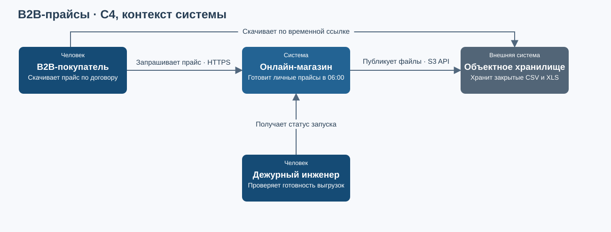

# Утренние прайсы для B2B

В 06:00 по часовому поясу магазина Kubernetes CronJob создаёт Job с контейнером экспортёра. На одного клиента приходится до 5–10 тыс. строк. Обработка сводится к соединению четырёх таблиц и форматированию результата. В существующем облачном кластере достаточно одного короткоживущего Pod на запуск.

| Критерий | Spring Batch | Apache Airflow | Kubernetes Job / CronJob | Spark |
|---|---|---|---|---|
| Расписание | Нужен внешний планировщик или Spring Scheduler | Cron, часовой пояс, история DAG | CronJob создаёт Job по cron и timeZone | Внешний планировщик запускает приложение |
| Логика | Reader, processor, writer, контрольные точки. Удобно при многошаговом импорте | DAG и готовые интеграции. Для одного JOIN появляется лишняя инфраструктура | SQL JOIN, потоковое чтение, запись CSV/XLS внутри контейнера | DataFrame и распределённый JOIN. Данные здесь помещаются в одной БД |
| Ресурсы | JVM и хранилище метаданных | Постоянно работают scheduler, web/API и metadata DB | Pod расходует CPU и память только во время экспорта | Driver, executors, сериализация и передача данных |
| Рост нагрузки | Партиционирование шагов, управление конкурентностью | Пулы и параллельные задачи по группам клиентов | Увеличить ресурсы или разделить клиентов между Job с лимитом параллельности | Горизонтальное масштабирование при действительно больших объёмах |
| Внедрение | Контейнер Java, подключение к БД, расписание | Развернуть или приобрести Airflow, сопровождать DAG и workers | Использовать существующий Kubernetes, Secret и service account | Управляемый Spark или отдельный оператор в кластере |
| Наблюдаемость | Метрики шагов, журнал выполнения в БД | UI, история задач, callbacks | Статусы Job, stdout, kube-state-metrics; прикладные счётчики добавляет экспортёр | Spark UI, event log и метрики executors |

## Контекст и поток данных

[Редактируемый исходник Draw.io](architecture.drawio). Планировщик, экспортёр и PostgreSQL входят в границу онлайн-магазина. Покупатель получает доступ к прайсу через личный кабинет. Объектное хранилище принимает закрытые файлы и обслуживает скачивание по короткоживущей подписанной ссылке.

1. Экспортёр открывает транзакцию PostgreSQL с уровнем REPEATABLE READ и фиксирует срез каталога. Ключи соединения — products.category_id → categories.id и client_prices.(client_id, product_id) → clients/products. Цена по договору имеет приоритет над базовой. Условия договора ограничивают видимость товаров.
2. Записи читаются курсором в порядке client_id, product_id. Для каждого клиента создаётся CSV в UTF-8 либо XLS согласно его настройке. Объём до 10 тыс. строк укладывается в лимит листа XLS.
3. Экспортёр пишет в префикс конкретного запуска и проверяет число строк и контрольную сумму. После успешной загрузки публикует указатель на готовую версию. Файлы разных клиентов разделены. При повторе за ту же дату старый комплект доступен до окончания новой выгрузки.

## План внедрения

1. Согласовать часовой пояс, валюты, точность цены, формат XLS/CSV и правила отбора. Утвердить тестовый договор с индивидуальной ценой и товаром без переопределения.
2. Снять EXPLAIN ANALYZE на типовом объёме, проверить составной индекс client_prices(client_id, product_id). Создать роль с правами SELECT и учётную запись записи только в нужный префикс хранилища.
3. Собрать контейнер. Настроить расписание `0 6 * * *`, явный timeZone, `concurrencyPolicy: Forbid`, deadline для отложенного запуска, backoffLimit и ограничения ресурсов.
4. Проверить два разных договора, корректность цен и заголовков, отказ БД и прерванную запись. Повторить экспорт за ту же дату и убедиться, что опубликованы только полные файлы.
5. Запустить в тестовом пространстве имён. Сравнить один комплект со старым процессом, затем включить расписание. Собирать длительность, число файлов, строк и время последнего успеха. Оповещать дежурного о пропуске утренней выгрузки.
