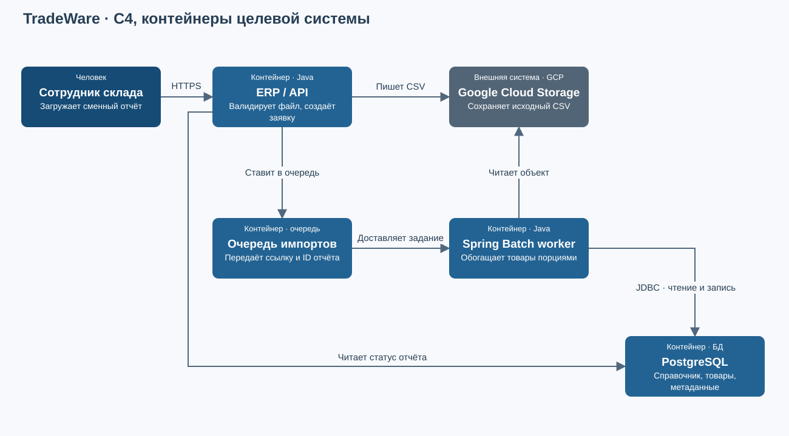

# ADR-01. Выделить импорт остатков в Spring Batch worker

**Статус:** принято для POC. **Участники:** команды Java, DevOps, складской логистики и поддержки TradeWare.

## Контекст и силы

ERP на Java 11/WildFly синхронно валидирует и обрабатывает отчёт. База уже в GCP, файлы — в GCS. При построчном обновлении до 400 тыс. строк за сутки импорт удерживает ресурсы одновременно с запросами сотрудников и партнёров. Сезонный пик увеличивает объём в 2–3 раза. Поддержке трудно связать ошибку с конкретным файлом.

Целевые условия — 100–150 параллельных загрузок и в среднем до 30 секунд на отчёт из 2 000 строк. Время ожидания в очереди входит в пользовательскую задержку. Эти значения задают условия приёмочного нагрузочного теста.

## Решение

ERP принимает файл, валидирует формат, сохраняет объект в GCS и возвращает ID регистрации. В целевой архитектуре запись заявки и событие outbox фиксируются в одной транзакции. Доставщик публикует ссылку в очередь. Worker забирает задание, потоково читает CSV и записывает товары порциями в PostgreSQL. ERP показывает состояние импорта по ID. Сотрудник может продолжать работу после регистрации загрузки.

В POC реализован сам worker на Java 17 отдельным процессом. Шаг Spring Batch читает product-data.csv, один раз за выполнение шага загружает малый справочник из loyality_data, обновляет атрибут товара по SKU и сохраняет порции по 100 строк в products. При отсутствии SKU остаётся значение из файла. Проверка количества запрещает отрицательный остаток. Метаданные batch_job_execution и batch_step_execution фиксируют исход, длительность и контрольную точку. Upsert по productid позволяет обработать тот же набор повторно без дублирования строк.

[Исходник диаграммы Draw.io](architecture.drawio). Очередь, ERP и GCS на схеме показывают целевое окружение. Для локальной проверки CSV поставляется вместе с приложением.

## Альтернативы

| Вариант | Оценка применимости |
|---|---|
| SQL COPY во временную таблицу + UPDATE FROM | Высокая пропускная способность на однородных отчётах. Хороший кандидат, если профилирование укажет на стоимость JDBC. Форматы, проверки, история шагов и повтор после сбоя потребуют дополнительной реализации. |
| Apache Airflow с внешним обработчиком | Уместен для расписаний и разных систем. Потребуются отдельный сервис вычислений, metadata DB и сопровождение оркестратора. |
| Spark | Распределённые трансформации полезны при росте данных за пределы одного worker. Задержка старта и обслуживание кластера существенны для коротких файлов. |
| Spring Batch | Совместим с Java-командой, поддерживает chunk-транзакции, restart и историю шагов. Отдельный worker позволяет независимо ограничивать потребление соединений и масштабировать обработку. |

## Последствия и проверка

- Хранить файл с версией объекта. В промышленном контуре использовать её с ID склада как идентификатор задания, чтобы повторная доставка сообщения не создавала новый импорт. Для разных версий одного остатка задать порядок по бизнес-дате и версии, чтобы устаревший отчёт не затёр свежий.
- Ограничить число одновременно исполняемых импортов и размер пула JDBC. Масштабирование worker ограничено пропускной способностью PostgreSQL. При росте справочника заменить загрузку в память порционным JOIN со staging-таблицей.
- До включения загрузок в ERP прогнать 100 и 150 одновременных файлов по 2 000 строк, измерить среднюю и p95 задержку от регистрации до фиксации результата, время в очереди, блокировки и насыщение пула. Проверить рестарт между чанками и конфликт двух отчётов по одному SKU.
- Локальный прогон демонстрирует обогащение и запись на пяти учебных строках. При переключении в облаке сначала сопоставить результаты старого и нового пути на копии данных, затем включать маршрутизацию по складам.
