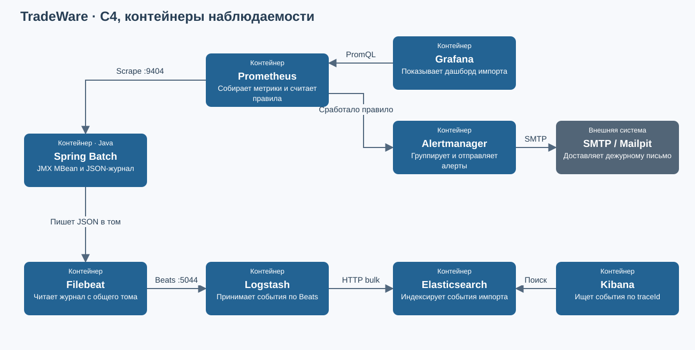

# Мониторинг и оповещения TradeWare



[Редактируемая диаграмма](architecture.drawio). Worker выставляет показатели выполнения через собственный JMX MBean. JMX Exporter работает Java-агентом в той же JVM и открывает HTTP endpoint для Prometheus. Grafana получает данные через PromQL. Правила исполняет Prometheus. Alertmanager группирует уведомления и отправляет их по SMTP. Mailpit принимает письма внутри локального стенда.

| Сигнал | Что показывает | Для чего используется |
|---|---|---|
| warehouse_import_completed_total | Успешные выполнения с момента старта процесса | Отличить простой от успешно завершённой обработки |
| warehouse_import_failed_total | Неуспешные выполнения | Правило WarehouseImportFailed срабатывает при росте за 5 минут |
| warehouse_import_rows_total | Сумма writeCount за завершённые задания, включая зафиксированные порции при сбое | Контроль объёма работы и скорости записи |
| warehouse_import_last_duration_seconds | Время последнего выполнения, секунды | Видеть замедление. Цель 30 секунд относится к среднему на отчётах в 2 000 строк; время последнего импорта на маленьком POC измеряет другой показатель |
| up | Успешность опроса JMX Exporter | WarehouseWorkerDown срабатывает после 20 секунд недоступности |

Идентификаторы отчёта и запроса имеют высокую кардинальность. Они попадают в логи. Метрики агрегируются по job и instance. Обе формы оповещения описаны в [правилах Prometheus](prometheus/rules.yml) и работают независимо от наличия открытого дашборда. Группировка по имени правила объединяет одинаковые ошибки. Для почты включены уведомления о восстановлении.

**Логи.** Spring Boot пишет JSON с временем, уровнем, сообщением и ошибкой. Слушатель добавляет ID выполнения, число строк и результат. Filebeat читает файл с выделенного тома и хранит позицию в собственном реестре. Logstash принимает события по Beats и отправляет в дневные индексы warehouse-batch-* в Elasticsearch. Такой путь не требует от приложения синхронного обращения к Elasticsearch и сохраняет журнал при пересоздании контейнера. Период хранения и ротацию архива следует согласовать с политикой компании.

## Запуск

Из корня репозитория:

```sh
docker compose -f task-4/results/compose.yaml -f task-5/results/observe.yaml up -d --build
```

- Grafana: `http://localhost:18430/d/warehouse-import`, локальный просмотр доступен без входа.
- Prometheus: `http://localhost:18490/alerts`. Правила вычисляются каждые 5 секунд.
- Kibana: `http://localhost:18456/app/discover`. Стенд создаёт представление warehouse-batch-*. Поиск последнего импорта: `message : "import.finished"`.
- Почта: `http://localhost:18426`. Для проверки WarehouseWorkerDown остановите сервис app на 30–40 секунд и запустите снова. Для проверки WarehouseImportFailed вызовите клиента задания 6 с параметром invalid.

Примеры с работающего стенда: [Grafana](evidence/grafana.png), [лог сбоя в Kibana](evidence/kibana-failure.png), [письмо Alertmanager](evidence/notifications.png), [значения метрик из Prometheus](evidence/metrics.json), [состояние правила](evidence/alert.json), [доставка письма при остановке worker](evidence/worker-down.json).
